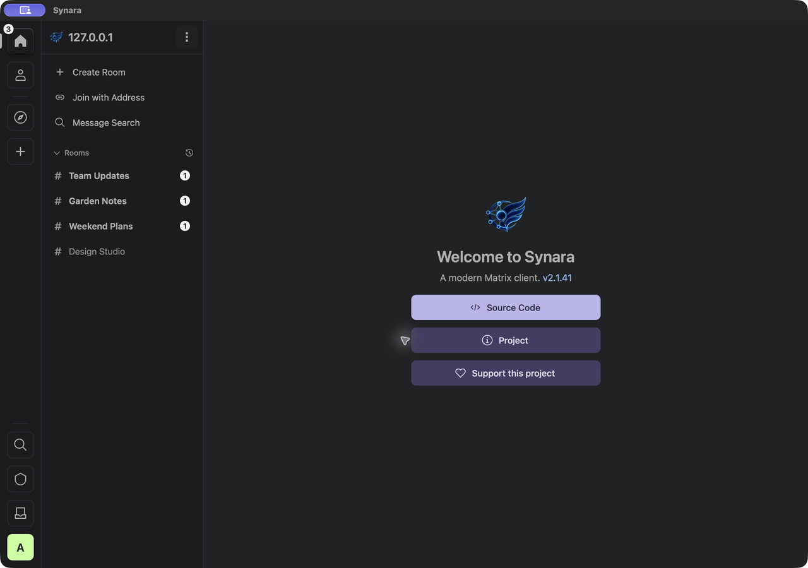
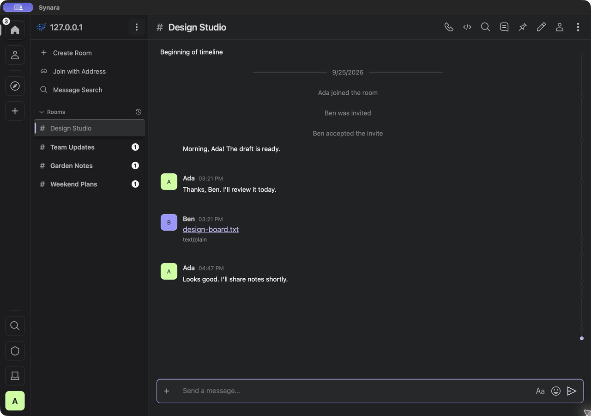
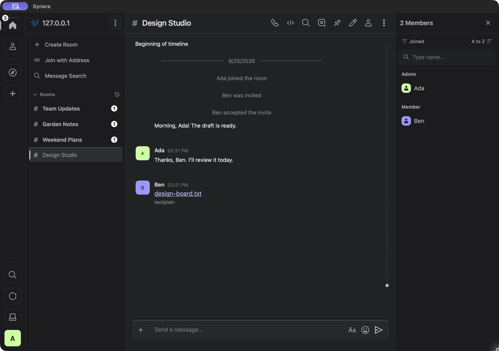
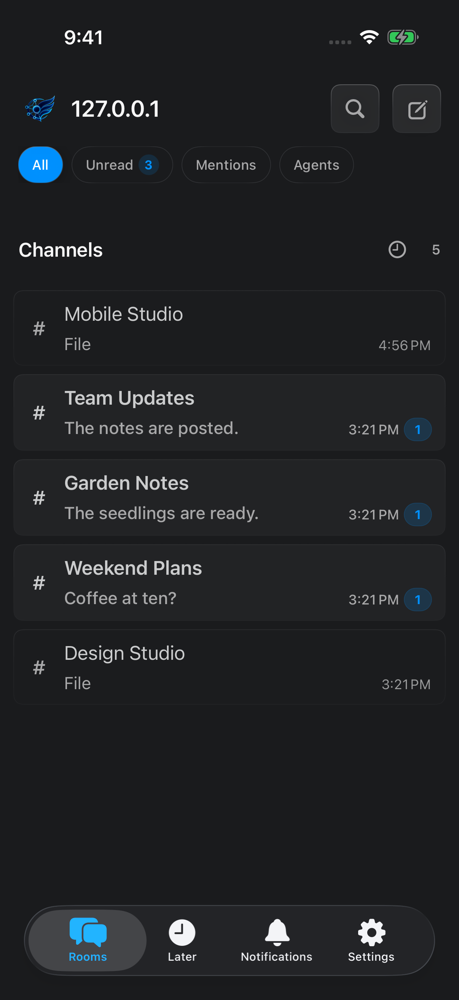
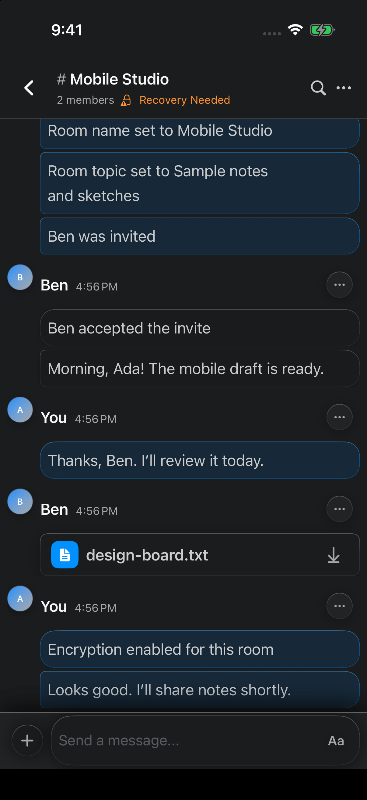
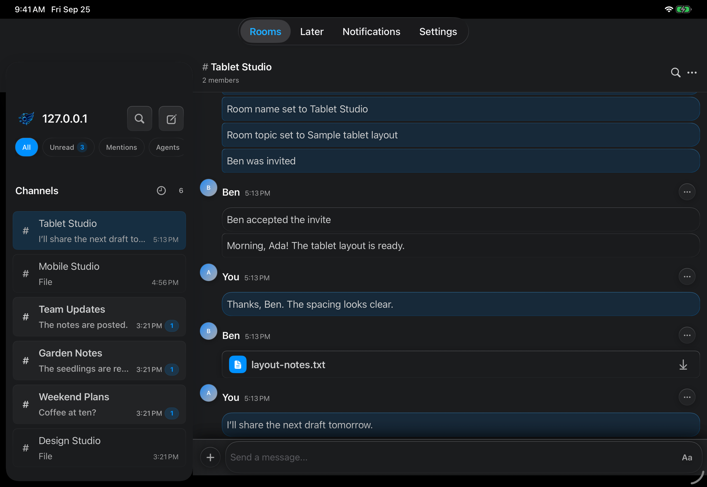

# Synara

Synara is an AGPL-3.0-only Matrix client for macOS, Linux and Windows, with a SwiftUI
iOS app that shares the same Rust core. It is a derivative of
[Cinny](https://github.com/cinnyapp/cinny). Copyright © 2026 Whyland Creative LLC.
See [NOTICE](NOTICE).

Public downloads are desktop builds. iOS is shared with internal TestFlight
testers and is not on the App Store or attached to GitHub Releases. Android, a
standalone web client, and voice or video calling are not supported.
The room header and voice rooms can show MatrixRTC call status, but Synara
does not start or join calls.

Synara does not ship a standalone browser client. The React/Vite package under
`synara/` is the application runtime embedded by the Tauri desktop shell.

## Install

Current desktop release: [v2.7.2](https://github.com/nepenth/synara-desktop/releases/tag/v2.7.2).
Every release is listed on the [releases page](https://github.com/nepenth/synara-desktop/releases),
and [CHANGELOG.md](CHANGELOG.md) describes each one.

| Platform                    | What you get                                                   | Where                                            | Updates                           |
| --------------------------- | -------------------------------------------------------------- | ------------------------------------------------ | --------------------------------- |
| macOS 13 or later           | Universal (Apple silicon and Intel) signed and notarized `DMG` | The `DMG` asset on that release                  | Built-in updater                  |
| Debian, Ubuntu, and related | x86_64 `.deb` and an APT repo (`Architectures: amd64`)         | [Linux install](docs/linux.md)                   | `sudo apt upgrade`                |
| Arch, CachyOS, and related  | x86_64 `synara-desktop-bin` pacman package and repo            | [Linux install](docs/linux.md)                   | `sudo pacman -Syu` or `paru -Syu` |
| Windows 10 or 11 (x64)      | x64 `.msi` installer and NSIS `-setup.exe` installer           | The `.msi` or `-setup.exe` asset on that release | Built-in updater                  |

Linux packages are x86_64 only. The iOS app needs iOS 16 or later and is
available only to internal TestFlight testers.

Windows is new in 2.6.0 and less proven than macOS and Linux. The installers
are not code-signed yet, so Windows SmartScreen warns the first time you run
one (choose "More info", then "Run anyway"). Updates install from inside the
app, as on macOS, but notifications have no action buttons, such as Approve,
on Windows. Secrets are kept in
Windows Credential Manager. Details are in
[docs/windows-support-spike.md](docs/windows-support-spike.md).

## Current capabilities

| In this release                                                                                                                                   | Not in this release              |
| ------------------------------------------------------------------------------------------------------------------------------------------------- | -------------------------------- |
| End-to-end encrypted messaging, rooms, spaces, threads, reactions, read receipts, and presence on the shared Rust core (`matrix-rust-sdk` 0.19.1) | Voice and video calls            |
| Device verification, secret storage and recovery, and identity reset through the Rust core                                                        | Android and a standalone web app |
| Klipy GIF search with `/gif`, inline GIF links, and X post previews with video, on desktop and iOS                                                | An ARM Linux package             |
| Desktop: password change                                                                                                                          |                                  |
| Agent approval requests with Approve, Deny, and Review actions from notifications, on desktop and iOS                                             | App Store distribution           |
| iOS app on the same core, internal TestFlight only                                                                                                |                                  |

## Interface

These screenshots show sample rooms on a disposable account. They were captured
in September 2026, so some details, such as direct-message avatars, have
changed since.

### macOS







### iOS







## Product Channels

| Client  | User interface  | Matrix/application core                           | Distribution                                        |
| ------- | --------------- | ------------------------------------------------- | --------------------------------------------------- |
| macOS   | Tauri 2 + React | Shared Rust core with native macOS adapters       | Signed/notarized universal DMG, Tauri updater       |
| Linux   | Tauri 2 + React | Shared Rust core with native Linux adapters       | x86_64 `.deb`/APT and Arch-family pacman repo       |
| Windows | Tauri 2 + React | Shared Rust core with native Windows adapters     | Unsigned x64 MSI and NSIS installers, Tauri updater |
| iOS     | SwiftUI         | Shared Rust core through generated Swift bindings | Internal TestFlight only                            |

Android and public web distribution are not currently supported.

## Architecture

The repository has one Matrix application engine and two native UI shells:

- `crates/synara-core/` owns shared Matrix lifecycle, room, timeline, messaging,
  account-data, and security behavior through `matrix-rust-sdk`.
- `src-tauri/` owns desktop-only concerns such as Keychain/Secret Service,
  windows, tray, shortcuts, notifications, file paths, and byte-oriented media
  transfer.
- `synara/` owns the desktop React UI, presentation state, Slate composer, and
  timeline virtualization. It is not a separately supported web product.
- `synara-ios/` owns the native SwiftUI app, Apple platform services, Keychain,
  APNs integration, and the notification service extension.

The generic shared-core command envelope excludes credentials, recovery material,
local file paths, and large media bytes. Narrow typed Core recovery APIs own SDK
operations and postconditions; shells retain user confirmation, secret custody,
one-time recovery-key display, and platform file/byte transfer.

See [ADR 0004](docs/adr/0004-rust-language-boundaries.md) for the binding
rules and [ADR 0003](docs/adr/0003-shared-native-rust-core.md) for the shared
core. [docs/shared-native-core/](docs/shared-native-core/README.md) is the
migration record, not a statement that the core is unfinished.

## Repository Layout

```text
.
|-- crates/synara-core/       Shared Rust application core
|-- crates/synara-nse-core/   Narrow notification-extension store/preview core
|-- crates/synara-core-bindgen/
|                             Swift binding generator
|-- src-tauri/                macOS/Linux/Windows native shell and adapters
|-- synara/                   Desktop React/Vite application runtime
|-- synara-ios/               Native SwiftUI application and extension
|-- devAssets/                Generated desktop runtime consumed by Tauri
|-- assets/branding/          App icon masters and the icon manifest
|-- examples/                 Sample widgets, such as the agent status widget
|-- scripts/                  Build, validation, release, and policy tooling
|-- integration/synapse/      Disposable local Synapse integration harness
|-- packaging/                Linux package metadata
|-- probes/                   Provenance records for retired SDK experiments
|-- docs/                     Architecture, operations, and historical records
`-- .github/workflows/        CI (fast gate + nightly) and release automation
```

`synara/` is a normal tracked directory, not a submodule. Fresh clones do not
need `--recursive` or any submodule command.

## Prerequisites

- Node.js at the exact version in `.node-version` (currently 24.13.1).
- Rust 1.96, pinned in `rust-toolchain.toml`. iOS builds also need the
  `aarch64-apple-ios` and `aarch64-apple-ios-sim` targets, which CI installs.
  Apple generation/export checks require `llvm-tools-preview` from that same
  toolchain: `rustup component add llvm-tools-preview --toolchain 1.96`.
  The read-only checker resolves `llvm-nm` from the selected `rustc` sysroot;
  it does not install tools or substitute Xcode's bitcode reader.
- Tauri 2 platform prerequisites.
- Xcode and XcodeGen for iOS work.
- Linux system packages documented in [docs/linux.md](docs/linux.md) for Linux
  builds.
- On Windows, the Tauri prerequisites (Microsoft C++ Build Tools and WebView2)
  plus Git for Windows. `npm run tauri` works from `cmd`, PowerShell or Git
  Bash, and `npm run tauri build -- --bundles msi,nsis` builds the installers.

Install JavaScript dependencies from the repository root:

```sh
npm ci
npm --prefix synara ci
npm run cache:setup
```

Rust builds use the pinned Kache 1.0.0 compiler cache. Tauri and Apple build
scripts configure it automatically after setup. Use `npm run cargo -- <arguments>`
for Rust commands, or export its environment with
`eval "$(scripts/setup-rust-cache.sh --env)"` before direct Cargo commands.
See the [cache runbook](docs/build-and-release.md#cache-families-and-writers)
for paths, sizing, statistics and cleanup.

## Desktop Development

Run the desktop application in development mode:

```sh
npm run tauri dev
```

Build the platform's default desktop bundle:

```sh
npm run tauri build
```

Build an ad-hoc local macOS application bundle:

```sh
npm run tauri build -- --bundles app
```

Build the desktop runtime without packaging:

```sh
npm run build:runtime
```

Edit the repository root `config.json` only. `scripts/build-runtime.mjs` copies
the canonical configuration and generated runtime into the locations consumed
by Tauri.

GIF search needs a Klipy API key, which is never committed. Export
`SYNARA_KLIPY_API_KEY` before building and `build:runtime` writes it into the
gitignored `devAssets/config.json`; without it, the GIF picker is turned off.
iOS builds write it into the gitignored
`synara-ios/Config/KlipyAPIKey.local.xcconfig` instead. Release and TestFlight
builds read the key from the repository secret of the same name.

## iOS Development

Generate the repository-local Swift bindings and XCFramework before opening a
clean checkout in Xcode:

```sh
scripts/generate-synara-core-swift.sh
cd synara-ios
xcodegen generate
```

Compile the app and test bundles for the simulator:

```sh
cd synara-ios
scripts/ci-build.sh
```

Run the simulator suite on an installed simulator:

```sh
cd synara-ios
RUN_IOS_TESTS=1 \
IOS_TEST_DESTINATION='platform=iOS Simulator,name=iPhone 17 Pro' \
scripts/ci-build.sh
```

Live Matrix tests require disposable accounts supplied through the local
environment. Credentials must never be added to source, fixtures, screenshots,
logs, or documentation.

## Validation

Before pushing, run the quick pre-push check. It covers Rust formatting,
clippy on the workspace crates you changed, the repository contract checks,
and Prettier, ESLint and typecheck for changed renderer files. See
[docs/build-and-release.md](docs/build-and-release.md#local-validation-gates).

```sh
npm run check:quick
```

Core repository checks:

```sh
npm run check:repo-layout
npm run check:versions
npm run check:docs
npm run check:matrix-boundaries
npm run check:workflows
npm run check:synapse-harness
npm run check:production-smoke
```

Desktop runtime checks:

```sh
npm --prefix synara run typecheck
npm --prefix synara run test:modernization
npm --prefix synara run test:browser:timeline
npm --prefix synara run check:eslint
npm --prefix synara run check:prettier
```

Rust checks:

```sh
cargo test --locked -p synara-core -p synara-nse-core -p synara-core-bindgen
cargo test --locked -p synara
```

These development-feature tests do not establish shipping NSE feature or archive
isolation. The complete release-oriented command list is maintained in
[docs/build-and-release.md](docs/build-and-release.md).

## Releases

All clients share one version. Use the repository version tool rather than
editing package metadata independently:

```sh
npm run bump:version -- X.Y.Z --ios-build X.Y.Z
```

Prepare a release on a `release/vX.Y.Z` branch and merge it into `main` once
its CI `Quality gate` passes. Pushing an exact `vX.Y.Z` tag at that merge commit
starts the coordinated release workflow. The workflow checks that the tag
matches the committed version, then requires the CI `Quality gate` that
already passed for that commit instead of rerunning the suite. It builds and
signs the macOS and Linux packages, builds the (not yet signed) Windows
installers, and publishes them all to GitHub Releases. The
iOS build uploads to internal TestFlight as a separate track that desktop
publication does not wait for.

Production signing, notarization, updater, TestFlight, and pacman repository
requirements are documented in
[docs/build-and-release.md](docs/build-and-release.md). Local builds use the
committed disabled-updater configuration and do not contact an update channel.

## Credential And Privacy Rules

This repository is public. Never commit:

- Matrix passwords, access tokens, refresh tokens, recovery keys, session
  exports, homeserver administration credentials, or private server details.
- Apple certificates, provisioning profiles, App Store Connect private keys,
  APNs keys, Developer ID material, or Tauri updater private keys.
- Third-party API keys, such as the Klipy GIF key.
- `.env` files, private URLs, personal filesystem paths, device identifiers,
  crash logs containing account data, or screenshots of non-disposable rooms.

Use ignored local environment files for disposable test accounts and an
external, permission-restricted directory for signing material. CI consumes
only named GitHub secrets and variables; documentation must contain names and
placeholders, never values.

## Documentation

Start with [docs/README.md](docs/README.md) for the current documentation map.
Architecture decisions live in [docs/adr/](docs/adr/README.md).

Dated plans, audits, handoffs, progress logs, and acceptance reports are kept
for engineering provenance. Unless a document explicitly says it is current,
its status, branch, version, commit, test count, and remaining-work statements
describe that historical snapshot. Current source, ADRs, validation contracts,
and release workflows take precedence.

## Community

- [Contributing](CONTRIBUTING.md)
- [Code of conduct](CODE_OF_CONDUCT.md)
- [Security reports](SECURITY.md). Do not file credentials or recovery keys in a public issue.

`probes/` holds provenance records for retired SDK experiments. Their executable
code, manifests, and lockfiles are removed; the README records identify the
Git revision containing the original experiments.
`docs/matrix-rust-sdk/` and `docs/shared-native-core/` are historical migration
records. Current architecture is the ADRs above.

## License

Synara is licensed under the GNU Affero General Public License v3.0 only
(AGPL-3.0-only), including the Affero clause: if you modify Synara and let
users interact with that modified version over a network, you must offer them
the corresponding source. Contributions stay under that license.

Synara is a derivative of Cinny. Preserve the attribution in [NOTICE](NOTICE).
See [LICENSE](LICENSE) for the full license text.
